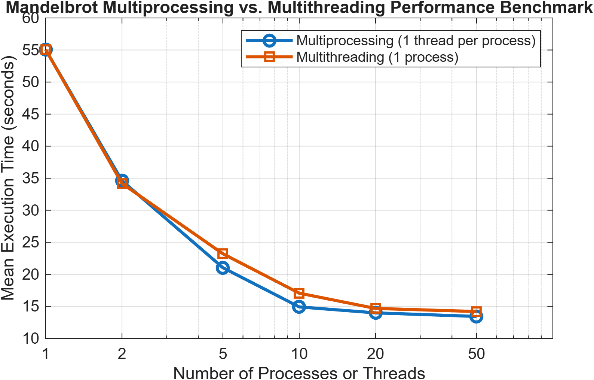
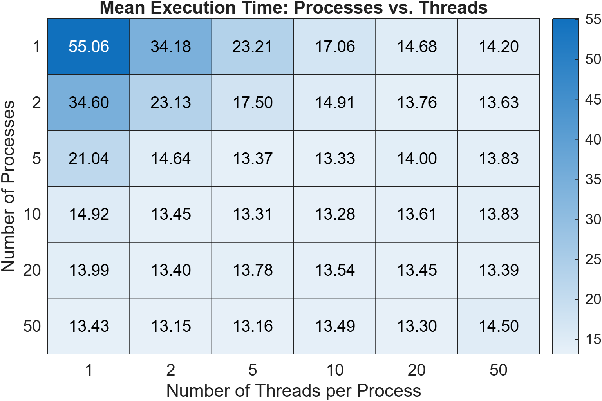

# CPE2600 Lab 12 - Multithreading
**Name:** Zach Campbell
**Course:** CPE2600
**Section:** 121
**Assignment:** Lab 12 - Multithreading

## Description

This project demonstrates multiprocessing and multithreading
using POSIX system calls and POSIX threads (pthreads) in C.

The project generates a 50-frame Mandelbrot zoom animation by 
launching multiple child processes. Each child process executes
the existing `mandel` program to generate an individual JPEG image.
Each Mandelbrot image can also be divided into multiple regions and
computed concurrently using POSIX threads.

The `mandelmovie` program controls the maximum number of concurrently
active child processes, while the `mandel` program controls the 
number of threads used to compute each image.

The assignment evaluates the performance of multiprocessing and
multithreading independently and in combination.

The assignment consists of five programs:

## Files

| File | Description |
| --- | --- |
| `mandel.c` | Generates individual Mandelbrot images |
| `jpegrw.c` | Provides JPEG image read/write functionality|
| `jpegrw.h` | Header files for JPEG functionality |
| `mandelmovie.c` | Creates child processes to generate animation frames|
| `benchmark.sh` | Measures execution time for different process counts|
| `benchmark_results.csv` | Contains raw benchmark measurements |
| `mandel.mpg` | Generated Mandelbrot animation |
| `lab12_independent_comparison.png`| Multiprocessing vs. Multithreading 
performance graph|
| `lab12_runtime_heatmap.png` | Combined multiprocessing and multithreading
performance heatmap|

## Compilation

Compile both programs using the provided Makefile:

```bash
make
```

To remove compiled executables and generated image/video files:

```bash
make clean
```
The Makefile uses GCC with the following compiler flags:
```bash
-Wall -Wextra -Werror
```

The JPEG library is linked using:
```bash
-ljpeg -pthread
```

## Execution

Run each program using the following commands:

### Animation generator
```bash
./mandelmovie -p <number_of_processes> -t <number_of_threads>
```
The -p argument specifies the maximum number of concurrently active
child processes.

The -t argument specifies the number of threads used by each child
process to generate its Mandelbrot image.

Examples:
```bash
./mandelmovie -p 1 -t 1
./mandelmovie -p 2 -t 2 
./mandelmovie -p 5 -t 5
./mandelmovie -p 10 -t 10
./mandelmovie -p 20 -t 20
```
Each execution generates 50 images

### Multiprocessing implementation
The `mandelmovie` program uses the following POSIX system calls:
- `getopt()` parses command line arguments
- `fork()` creates child processes
- `execl` executes Mandelbrot image generator
- `waitpid()` waitsffor child processes to complete and retrive their exit status

The parent process maintains an active child counter to enforce the specified
concurrency limit.

The image is partitioned amoned the requested number of threads. Each thread recieves 
a structure containing the image data, computation boundaries, and assigned row range.

The program uses the following pthread functions:
- `pthread_create()` creates worker threads
- `pthread_join()` waits for worker threads to complete
- `pthread_t` stores thread identifiers

After all worker threads finish computing their assigned image regions, the main thread
writes the completed image to a JPEG file.

Thread data and dynamically allocated thread arrays are released after computation.

When the maximum number of active children is reached, the parent waits for a child
to finish before creating another. After all 50 frames have been scheduled, the 
parent waits for all remaining children to terminate.

### Video generation
After generating all 50 JPEG frames, FFmpeg converts them into an MPEG video:
```bash
ffmpeg -framerate 25 -i mandel%d.jpg -c:v mpeg1video -q:v 2 mandel.mpg
```

FFmpeg converts the generated JPEG frames into an MPEG video

### Performance Analysis
The benchmark evaluates six process counts and six thread counts:
- Processes: 1, 2, 5, 10, 20
- Threads: 1, 2, 5, 10, 20

Each configuration was executed 5 times resulting in 180 total measurements
across 36 configurations.

The benchmark records the execution time for generating all 50 Mandelbrot 
frames.

### Independent multiprocessing and multithreading
The following results isolate each parallelization method by holding the 
other variable at one.

| Processes | Threads | Mean Runtime (seconds) |
| --- | --- |
| 1 | 1 | 55.062 |
| 2 | 1 | 34.602 |
| 5 | 1 | 21.036 |
| 10 | 1 | 14.918 |
| 20 | 1 | 13.990 |
| 50 | 1 | 13.434 |
| 1 | 2 | 34.182 |
| 1 | 5 | 23.212 |
| 1 | 10 | 17.064 |
| 1 | 20 | 14.682 |
| 1 | 50 | 14.198 |

### Combined multiprocessing and multithreading
The following table shows the average execution time for all 36 process/thread
configurations.

| Processes / Threads | 1 | 2 | 5 | 10 | 20 | 50 |
|---:|---:|---:|---:|---:|---:|---:|
| 1 | 55.062 | 34.182 | 23.212 | 17.064 | 14.682 | 14.198 |
| 2 | 34.602 | 23.130 | 17.496 | 14.908 | 13.758 | 13.632 |
| 5 | 21.036 | 14.638 | 13.374 | 13.332 | 13.998 | 13.830 |
| 10 | 14.198 | 13.448 | 13.306 | 13.284 | 13.612 | 13.830 |
| 20 | 13.990 | 13.398 | 13.780 | 13.544 | 13.448 | 13.394 |
| 50 | 13.434 | 13.512 | 13.156 | 13.490 | 13.300 | 14.504 |

### Performance Analysis

The baseline configuration of one process and thread averaged 55.062 seconds.

Multiprocessing alone reduced the average execution time to 13.434 seconds 
using 50 processes and one thread per process. This represents approximately
a 4.10x speedup over the baseline.

Multithreading alone reduced the average execution time to 14.19 seconds 
using one process and 50 threads. This represents approximately a 3.88x 
speedup.

The best combined confuguration was 50 processes with two threads per 
process, averaging 13.152 seconds. This represents approximately a 4.19x
speedup and a 76.1% reduction in execution time compared to the baseline.

The benchmark was perfomred on a system with 14 available logical 
processors. Configurations with more than 14 total worker threads require
the operating systmem to schedule multiple workers across the available
logical processors.

The resuls demonstrate that both multiprocessing and multithreading 
significantly improve execution time. However, increasing the number
of processes and threads does not produce proportional performance
improvements.

In particular, configurations with higher levels of parallelism
generally approached 13-14 seconds. The 50-process, 50-thread
configuration averaged 14.504 seconds, which was slower than
several configurations using fewer threads. 

This behavior demonstrates diminishing returns caused
by process creation, thread scheduling, synchronization,
resource contention, and other execution overhead.

The results suggest that effective parallelization requires
balancing the number of processes and threads against the 
available hardware resources and the overhead associated with
concurrent execution.

## Requirements

- Linux operating system
- GCC compiler
- GNU Make
- POSIX process management functionality
- POSIX threads (pthreads)
- JPEG development library
- FFmpeg (for video generation)
- MATLAB (for benchmark visualization)