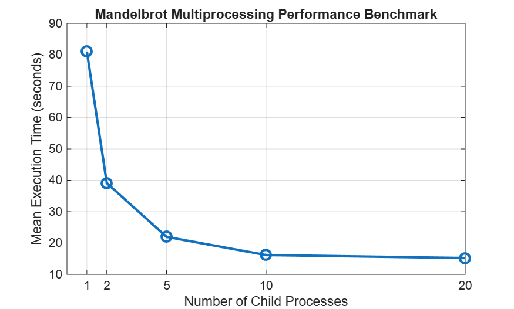

# CPE2600 Lab 11 - Multiprocessing
**Name:** Zach Campbell
**Course:** CPE2600
**Section:** 121
**Assignment:** Lab 11 - Multiprocessing

## Description

This project demonstrates creation, execution, synchronization, and 
concurrent processing using POSIX system calls in C.

The project generates a 50-frame Mandelbrot zoom animation by 
launching multiple child processes. Each child process executes
the existing `mandel` program to generate an individual JPEG image.

The parent process controls the maximum number of concurrently 
active child processes and waits for their completion.

The assignment consists of five programs:

## Files

| File | Description |
| --- | --- |
| `mandel.c` | Generates individual Mandelbrot images |
| `jpegrw.c` | Provides JPEG image read/write functionality|
| `jpegrw.h` | Header files for JPEG functionality |
| `mandelmovie.c` | Creates child processes to generate animation frames|
| `benchmark.sh` | Measures execution time for different process counts|
| `benchmark_results.csv` | Contains raw benchmark measurements |
| `mandel.mpg` | Generated Mandelbrot animation |

## Compilation

Compile both programs using the provided Makefile:

```bash
make
```

To remove compiled executables and generated image/video files:

```bash
make clean
```
The Makefile uses GCC with the following compiler flags:
```bash
-Wall -Wextra -Werror
```

## Execution

Run each program using the following commands:

### Animation generator
```bash
./mandelmovie -p <number_of_processes>
```
The -p argument specifies the maximum number of concurrently active
child processes.

Examples:
```bash
./mandelmovie -p 1
./mandelmovie -p 2
./mandelmovie -p 5
./mandelmovie -p 10
./mandelmovie -p 20
```
Each execution generates 50 images

### Multiprocessing implementation
The `mandelmovie` program uses the following POSIX system calls:
- `getopt()` parses command line arguments
- `fork()` creates child processes
- `execl` executes Mandelbrot image generator
- `waitpid()` waitsffor child processes to complete and retrive their exit status

The parent process maintains an active child counter to enforce the specified
concurrency limit.

When the maximum number of active children is reached, the parent waits for a child
to finish before creating another. After all 50 frames have been scheduled, the 
parent waits for all remaining children to terminate.

### Video generation
```bash
ffmpeg -framerate 25 -i mandel%d.jpg -c:v mpeg1video -q:v 2 mandel.mpg
```

FFmpeg converts the generated JPEG frames into an MPEG video

### Performance Analysis

| Child Processes | Mean Runtime (seconds) |
| --- | --- |
| 1 | 81.030 |
| 2 | 39.110 |
| 5 | 21.970 |
| 10 | 16.174 |
| 20 | 15.220 |

Increasing the number of child processes significantly reduced the execution time.

- The single process configuration required an average of 81.030
- The 20 process configuration required only 15.220
- This represents an approximately 5.32x speedup
- The speedup from 10 to 20 process was only 5.9%

This demonstrates that increasing concurrency does not necessarily produce
proportional performance improvements. Process scheduling overhead, resource 
contention, and available hardware resources influence overall execution time.

## Requirements

- Linux operating system
- GCC compiler
- GNU Make
- POSIX-compliant signal handling functionality